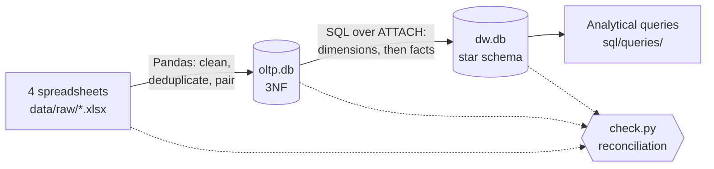

# Financial Star Schema

A data warehousing project that loads messy spreadsheet data into a normalized relational database (OLTP), then into a star schema (OLAP) for analytical queries. Built with Python, Pandas, SQLite and Matplotlib.

> **About the data:** the files in `data/raw/` are anonymized and altered sample data, so results from this project don't reflect any real business. The 2022-2023 files are also a copy of the 2020-2021 files with different years (see [data quality](docs/data_quality.md)), so no result should be read as growth or a trend.

## Quick start

You need Python 3.13. With conda:

```bash
conda create -n star-schema python=3.13 -y
conda activate star-schema
python -m pip install -r requirements.txt
python run_all.py
```

`run_all.py` rebuilds everything from the spreadsheets. It deletes and regenerates `oltp.db` and `dw.db`, checks the result, and prints the results of every analytical query. Each step can also be run on its own, in this order:

| Command | What it does |
|---|---|
| `python src/migrate.py` | Cleans the four spreadsheets with Pandas and loads them into `oltp.db` |
| `python src/etl.py` | Builds the star schema in `dw.db` and loads it from `oltp.db` |
| `python src/check.py` | Reconciles row counts and totals, and tests the constraints |
| `python src/charts.py` | Plots profit by segment and margin by discount band, saves them to `charts/` and opens them in a window |

## How it works



1. **Source data:** Sales and Manufacturing spreadsheets for 2020-2021 and 2022-2023. Each sales row and the manufacturing row at the same position describe one sale. [`docs/data_quality.md`](docs/data_quality.md) lists every problem found and how it is handled: typos, a merged column that breaks 1NF, 15 duplicate rows, and `"None"` being read as missing.
2. **OLTP database:** 6 tables in 3NF, with `STRICT` types, foreign keys and `CHECK` constraints. Derived amounts are computed in a view, not stored. See [`docs/oltp_model.md`](docs/oltp_model.md).
3. **Data warehouse:** a star schema with one fact table (`fact_sales`, one row per sale line, 1,358 rows) and five dimensions: date, segment, country, product and discount band. See [`docs/dw_model.md`](docs/dw_model.md).
4. **ETL:** [`sql/etl.sql`](sql/etl.sql) runs over `ATTACH DATABASE`, loading the dimensions first and then the fact table. It is a full refresh in one transaction, so a re-run gives the same result.
5. **Reconciliation:** [`src/check.py`](src/check.py) confirms that the spreadsheets, `oltp.db` and `dw.db` have the same 1,358 sales and the same totals for units, sales, COGS and profit. It also checks that there are no broken foreign keys and that bad inserts are rejected.
6. **Analytical queries:** six business questions answered with joins, `GROUP BY`, `WHERE` and one `RANK`. Each query is a file in [`sql/queries/`](sql/queries/), and `run_all.py` prints their results. [`src/charts.py`](src/charts.py) plots two of them with Matplotlib.

## Main results

- **Public Sector** brings in 67% of total profit.
- **Corporate** loses money on every product, because its unit cost (135) is almost its sale price (140).
- **Discounts** drive margin down from 19.9% with no discount to 7.1% in the High band, and every loss-making sale is a discounted Corporate sale.
- **The 2022-2023 data** repeats 2020-2021 almost row for row, so the two periods can't be compared as growth.

## Project layout

| Path | Contents |
|---|---|
| `data/raw/` | The four source spreadsheets |
| `src/` | Python code: `migrate.py`, `etl.py`, `check.py` and `charts.py` |
| `sql/` | Schemas (`oltp_schema.sql`, `dw_schema.sql`), the ETL (`etl.sql`) and `queries/` |
| `docs/` | Data-quality notes and model descriptions with diagrams |
| `notebooks/` | Data exploration |
| `run_all.py` | Rebuilds everything |

`oltp.db` and `dw.db` are generated and are not committed.
